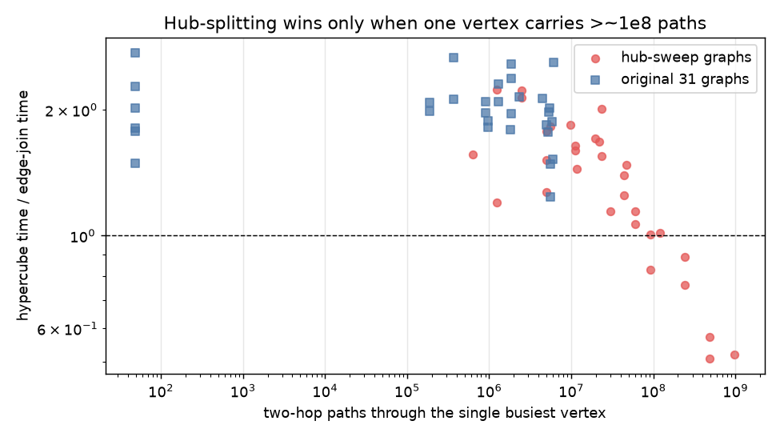
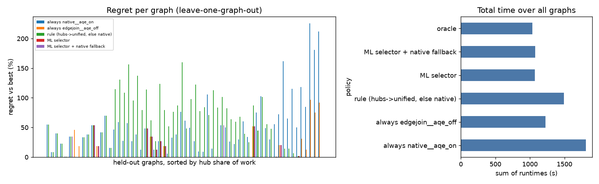

# ML-Guided Selection of Graph-Query Execution Strategies in Apache Spark

*Project report. All numbers come from `datasets/derived/selector_v2/results.json` and `datasets/derived/training/combined_table.csv`, produced by `notebooks/selector.ipynb`. Date of final run: 2026-10-20.*

## Abstract

Spark can execute the same graph pattern query in several ways, and the best way depends on how skewed the graph is. We study the directed two-hop motif `(a)-[e1]->(b); (b)-[e2]->(c)` on Spark 3.5.5 with GraphFrames 0.8.3 and compare GraphFrames' native `find`, a plain edge join, one-dimensional salting, and a hub-aware hypercube (Shares-style) join, with Spark's adaptive query execution (AQE) on and off. We built 60 synthetic graphs plus a 31-graph "hub sweep" with one to eight planted hubs holding 50–99.5 % of all two-hop work, and benchmarked them on one 2-core machine with a correctness gate and median-of-repeated-runs timing. We then trained models that choose a strategy from graph-shape features known before running. The main empirical finding is negative and specific: on a 2-core machine a plain edge join is fastest on the large majority of graphs; hub-splitting becomes faster only when a *single* hub holds roughly 95 % or more of a large amount of work. Classifiers therefore barely beat the majority-class baseline overall (best 85.5 % vs 80.6 % leave-one-graph-out); a learned runtime model gives the lowest regret among the deployable policies (4.6 % vs 8.3 % for always-edge-join), and nearly all of its gain comes from recognising the single-hub regime. It does not generalise to unseen graph families, and it ignores the cost of computing its own features. All scores are reported beside their baselines.

## 1. Introduction

Motif and pattern queries on property graphs reduce to multiway joins over edge tables. When a few vertices have very high degree, a join keyed on the vertex produces a straggler task that dominates runtime (data skew). Systems offer several mitigations: Spark's AQE can split oversized shuffle partitions at run time; salting spreads a hot key over artificial buckets; and hypercube (Shares) partitioning assigns tuples to a multi-dimensional grid of reducers. Each mitigation has set-up cost (profiling to find hubs, replicated data, extra shuffles), so none is best everywhere. The question we ask is practical: *can a model look only at cheap graph statistics and pick the strategy that is actually fastest, and how much does it gain over a fixed default?*

Contributions: (1) a reproducible benchmark protocol (fresh Spark application per graph, correctness gate against the exact path count, interleaved and reshuffled repetitions, medians with IQR, append-only raw records); ((2) a synthetic hub-sweep generator that controls the share of work held by hubs; (3) an honest evaluation of classifiers, a runtime regressor and a selector under held-out-graph, held-out-group and held-out-seed splits, each beside its majority-class baseline and an oracle.

## 2. Related work

- **GraphFrames** (Dave et al., GRADES 2016) provides motif finding as relational queries over vertex and edge DataFrames in Spark; it is our `native` baseline. [GraphFrames paper](https://people.csail.mit.edu/matei/papers/2016/grades_graphframes.pdf)
- **Adaptive query execution** in Spark SQL re-optimises at run time, including splitting skewed partitions of a sort-merge join when they exceed configured thresholds. [Databricks AQE blog](https://www.databricks.com/blog/2020/05/29/adaptive-query-execution-speeding-up-spark-sql-at-runtime.html). In our runs AQE skew splitting never triggered because no partition reached the 256 MB threshold at these data sizes.
- **Salting** is the standard manual remedy for hot keys: split the heavy key into several sub-keys and replicate the other side.
- **Shares / hypercube partitioning** (Afrati and Ullman, 2011) assigns tuples to a grid of reducers to optimise multiway joins in MapReduce. [Optimizing multiway joins in a map-reduce environment](https://ieeexplore.ieee.org/abstract/document/5710932). Our hub-aware variant applies the grid only to hub keys.
- **Learned optimisers.** Bao steers an existing optimiser by learning which hint sets to use ([Bao, SIGMOD 2021](https://people.csail.mit.edu/tatbul/publications/bao_sigmod21.pdf)); Lero learns to rank candidate plans ([Lero, VLDB 2023](https://www.vldb.org/pvldb/vol16/p1466-zhu.pdf)). Our selector is in the same spirit — predict cost per option, choose the cheapest, fall back to a safe default — but chooses among whole execution strategies using pre-execution graph statistics rather than plan features.

## 3. Method

**Query and strategies.** The query counts directed two-hop paths. Strategies are `<variant>__aqe_<on|off>`: `native` (GraphFrames `find`), `edgejoin` (plain self-join on `e1.dst = e2.src`), `salt1d` (hub keys split into 100 buckets), `hypercube` (hub and non-hub branches), `hypercube_unified` (single pass, same hub planner). AQE-on pins skew join on with a 256 MB threshold and factor 5.

**Work and hubs.** For vertex `v`, the number of two-hop paths through it is `d_in(v)·d_out(v)`; `work_sum` is their sum, i.e. the exact result size. A *hub* is a vertex with work above 1 000 000 (the planner's default).

**Graphs.** (a) 60 synthetic graphs: five families (uniform, balanced power law, in-heavy, out-heavy, multi-hub) × three sizes (0.1/0.5/1 M vertices) × four seeds, 31 of them benchmarked; (b) a hub sweep with a uniform background (7 random edges per vertex, 100 k vertices) plus planted hubs sized so that the planned share of work sits in the hubs, at 1–8 hubs and shares 50 %–99.5 %, two seeds.

**Measurement.** One fresh Spark application per graph, local mode, 2 vCPU, 7.8 GB, 200 shuffle partitions, broadcast off. A correctness gate requires every strategy to reproduce the path count and checksums. Then one warm-up and 5 (original graphs), 3 (sweep graphs up to 0.25 B paths) or 2 (the three 0.5–1 B-path graphs) measured runs, with strategy order reshuffled each round. The recorded cost is the median of `total_s = profiling + query` time; IQR is kept. All rows come from one machine and one Spark configuration (the builder refuses to merge otherwise); only the number of repetitions differs and is recorded in a `protocol` column.

**Features (13 inputs).** Log vertex and edge counts, active-vertex fraction, in/out Gini, log in/out 99.9th-percentile degree, log total work, share of work through the busiest vertex, log number of work hubs, share of work in hubs, and log absolute work in hubs, and log work through the single busiest vertex (the last two are computed from the earlier features only). No runtime or strategy information is ever an input.

**Models.** Classification of the best *class* (edge-join / hub-splitting / native): majority guess, a fixed rule, logistic regression, depth-2 decision tree, random forest, extra-trees. Regression: a multi-output random forest predicts log median runtime for every strategy; the selector takes the argmin, optionally falling back to native unless the predicted gain exceeds 5 %.

**Evaluation.** Only on unseen graphs: leave-one-graph-out (LOGO), leave-one-structural-group-out (LOSG) and a held-out generator seed (SEED202). Reported: accuracy beside the majority baseline, macro-F1, regret (chosen ÷ best − 1), geometric-mean speed-up over native, and an oracle. Outcomes are look-ups of measured medians, not new runs.

## 4. Data

| Set | Graphs | Strategies | Timed runs / strategy | Notes |
|---|---:|---|---:|---|
| Original families | 31 (of 60 generated) | edge-join (AQE off), native (AQE on), hypercube_unified (+4 others, not used here) | 5 | 0.1–1 M vertices; two-hop work 4.5 M – 205 M; busiest vertex holds at most 12 % of work |
| Hub sweep A | 12 | 4 (incl. salt1d) | 3 | 1/2/4/8 hubs × 80/90/95 % hub share, seed 101 |
| Hub sweep B | 8 | 3 | 3 | 1/2/4/8 hubs × 50/98 % |
| Hub sweep C | 8 | 3 | 3 | seed 202 replication, 1 or 4 hubs |
| Big single hub | 3 | 3 | 2 | one hub at 99 % (seeds 101, 202) and 99.5 % (seed 101): 0.49–0.98 B paths |
| **Combined table** | **62** | 3 labelled strategies | | 13 input features; 43 columns |

All graphs have 100 k–1 M vertices and ≈ 7 edges per vertex; the remaining 29 generated original graphs were not benchmarked (documented exclusion: 8–14 h of machine time). Salting was measured on the original graphs and sweep A and was never fastest (1.5–3 × slower than edge-join), so it was dropped from the later sweeps to save time; its medians stay in the table as a diagnostic column. Across the 31 original and 31 sweep graphs there were 0 failed runs, 0 timeouts and 0 wrong results (every strategy matched the exact path count `work_sum` and the checksums of native). Spark's AQE skew splitting never fired in any recorded run.

Labels (best strategy by median total time): edge-join 50, native 6, hub-splitting 6. The majority class is 80.6 %. Only 32 of 62 labels are "clear" (lead over the runner-up exceeds both IQRs): edge-join 25, hub-splitting 6, native 1 — most native "wins" are noise-level ties with edge-join.

## 5. Results

### 5.1 Which strategy wins, and when

* **Edge-join beats native GraphFrames on 56 of 62 graphs**; the median native/edge-join time ratio is 1.38 (1.35 on the original graphs, 1.49 on the sweep graphs).
* **Hub-splitting (hub-aware unified hypercube) is fastest on exactly six graphs, all single-hub graphs** with 93 M – 981 M paths through the busiest vertex. Its time relative to edge-join falls from 0.83 at 98 M paths to 0.51–0.57 at 0.49–0.98 B paths (1.2×–2.0× faster than edge-join, 1.7×–3.3× faster than native). The two largest-hub graphs of each seed confirm the pattern, and seed 202 reproduces seed 101.
* **With 2, 4 or 8 equal hubs the win disappears** even at 98 % hub share (ratio 1.02–1.15): the hubs' work is spread over several tasks and cores anyway, so the straggler that hub-splitting removes is smaller than its set-up cost.
* The unified hypercube pays 7–10 s of profiling per graph (median `profiling_s` 9.1 s over all graphs). On single-hub graphs its *query phase alone* is faster than edge-join at every size we timed (about 1.3–1.5× at 1e7–1e8 paths, about 2× at 0.5–1 B paths), but the profiling cost cancels that gain until roughly 1e8 paths pass through the hub.

### 5.2 Classification of the best class (leave-one-graph-out, 62 graphs)

| Model | Accuracy | Balanced acc. | Macro-F1 | Acc. on clear labels |
|---|---:|---:|---:|---:|
| **Majority guess (always edge-join)** | **80.6 %** | 33.3 % | 0.298 | 78.1 % |
| Fixed rule (hubs → hypercube else native) | 14.5 % | 50.0 % | 0.171 | 18.8 % |
| Logistic regression | 75.8 % | 75.3 % | 0.656 | 93.8 % |
| Depth-2 decision tree | 51.6 % | 55.6 % | 0.528 | 65.6 % |
| One-threshold stump on busiest-vertex work | 85.5 % | 59.8 % | 0.561 | 93.8 % |
| Random forest (300 trees) | 83.9 % | 68.9 % | 0.678 | 93.8 % |
| **Extra-trees (300)** | **85.5 %** | 69.6 % | 0.703 | 93.8 % |

Reading: the best accuracy, 85.5 %, is 4.9 points above the majority baseline — on 62 graphs, about three graphs' worth, which is within the noise of the labels. The models do learn the hub-splitting class (stump, random forest and extra-trees find 5 of the 6 hub-splitting graphs; logistic regression finds 6 of 6 but misclassifies many edge-join graphs) but not the native class, whose six wins are mostly ties with edge-join and are not predictable from shape. On the held-out generator seed (9 graphs) the best models reach 77.8 % vs a 55.6 % majority baseline. Leave-one-structural-group-out (an entire family or an entire hub count unseen) gives no gain over the majority (best 80.6 %, equal to the majority baseline): the models interpolate between graphs of known type and do not extrapolate. The 13-input feature set did not beat the 11 base features in the random forest (83.9 % vs 85.5 %), so the two derived inputs are not justified by accuracy alone; feature importance puts the busiest-vertex work (0.19), the busiest-vertex share (0.17) and total work (0.12) on top.

### 5.3 Runtime regression and the selector (leave-one-graph-out)

A multi-output random forest predicting log runtime has R² 0.889 (log scale), median error 10.1 %, per-graph Spearman 0.855 and the true best strategy in its top-2 for 100 % of graphs (top-1 82.3 %). Choosing the argmin gives:

| Policy | Class acc. | Mean regret | Worst regret | Geomean speed-up vs native | Sum of times |
|---|---:|---:|---:|---:|---:|
| Always native (AQE on) | 9.7 % | 49.5 % | 226 % | 1.00× | 1810 s |
| Always edge-join (best fixed) | 80.6 % | 8.3 % | 96 % | 1.34× | 1226 s |
| Rule: hubs → hypercube, else native | 14.5 % | 56.9 % | 160 % | 0.95× | 1490 s |
| **ML selector** | 82.3 % | **4.6 %** | 53 % | **1.38×** | **1070 s** |
| ML selector + native fallback (5 %) | 79.0 % | 6.1 % | 54 % | 1.36× | 1079 s |
| Oracle | 100 % | 0 % | 0 % | 1.43× | 1037 s |

The selector closes 83 % of the gap between the best fixed policy and the oracle in total time (1226 → 1070 s against 1037 s) and cuts mean regret from 8.3 % to 4.6 %. In the skewed regime (busiest vertex ≥ 90 % of the work; 7 graphs, 6 of them hub-splitting) its mean regret is 3.0 % versus 46.9 % for always-edge-join. On the held-out seed (9 graphs) it has 7.3 % regret versus 18.5 % for always-edge-join and a 1.59× geometric-mean speed-up (oracle 1.69×). The native fallback made results slightly worse here (6.1 % regret), because native is rarely the right answer. Under leave-one-group-out the selector is no better than always-edge-join (mean regret 8.3 % for both).

### 5.4 Overhead

Inference takes 14 ms per graph. Feature extraction was not measured separately. The nearest measured proxy is the degree/work profiling pass of the hub-aware strategy, 9.1 s median; if obtaining the features cost that much, the selector's geometric-mean speed-up over native would fall from 1.36× to 0.84× — i.e. the benefit would be wiped out on graphs that take 10–25 s anyway. The selector pays off only if the statistics can be obtained much more cheaply than a full profiling pass (for example from cached or sampled degree counts), or on graphs where runs take minutes (on the 0.5–1 B-path graphs the right choice saved 35–75 s against edge-join and 85–170 s against native).

## 6. Discussion and limitations

* **The main finding is a regime map, not a classifier.** On a 2-core machine edge-join is the right default; hub-splitting helps only for one dominant hub with roughly 1e8+ paths; native GraphFrames is almost never best. The cheapest deployable policy is therefore a threshold on one statistic (work through the busiest vertex), which the stump found and the tree models approximate.
* **The 85 % target.** Leave-one-graph-out accuracy of 85.5 % is reached by two models but is only 4.9 points above the 80.6 % always-edge-join baseline; balanced accuracy is 60–70 %. We do not claim a learned classifier is much better than a default here.
* **One machine, 2 cores, local mode.** With more cores a skewed task matters less in some respects and the grid in others; the crossover will move. The result does not transfer to a cluster without re-measurement.
* **Small, partly synthetic data.** 62 graphs, 31 of them from one generator recipe; six hub-splitting examples, all single-hub and all from that recipe. Generalisation to real graphs with several moderate hubs is untested (Pokec was validated but is too large to benchmark here).
* **Unequal repetition counts** (5/3/2 runs) mean medians of the big graphs are less certain; however, their margins (0.5× runtime) are far larger than the observed noise.
* **No AQE skew regime.** AQE skew splitting never triggered (256 MB threshold); its benefit is untested.
* **Derived features were chosen after seeing the sweep** (`log_max_work`), so the 13-feature results are not a clean pre-registered test; the 11-feature results are given beside them.
* Salting was dropped from later sweeps after it was never competitive (measured on 43 graphs).

## 7. Reproducibility

`datagen/` (generators, `hub_sweep.py`), `bench/run_phase1.py` (campaigns, append-only JSONL under `datasets/raw_runs/`), `bench/phase1_aggregate.py`, `ml/build_feature_table.py`, `ml/build_combined_table.py`, `notebooks/_build_selector_notebook.py` → `notebooks/selector.ipynb` (executed with `NB_TREES=300`). Raw campaigns used: pilot-full, pilot-hubs, pilot-ext1, pilot-ext2 (original graphs); hubsweep-sweep_a, sweep_b, sweep_c, sweep_big, sweep_big202 (hub sweep). The earlier probe (3 graphs, 2 runs) and one empty campaign record (`hubsweep-sweep_big-31949d`, 0 graphs, skipped because Spark validation had not yet run) are kept but not used for training.

## References

1. A. Dave, A. Jindal, L. E. Li, R. Xin, J. Gonzalez, M. Zaharia. GraphFrames: an integrated API for mixing graph and relational queries. GRADES 2016. https://people.csail.mit.edu/matei/papers/2016/grades_graphframes.pdf
2. Databricks. Adaptive query execution: speeding up Spark SQL at runtime (2020). https://www.databricks.com/blog/2020/05/29/adaptive-query-execution-speeding-up-spark-sql-at-runtime.html
3. F. N. Afrati, J. D. Ullman. Optimizing multiway joins in a map-reduce environment. IEEE TKDE 2011. https://ieeexplore.ieee.org/abstract/document/5710932
4. R. Marcus et al. Bao: making learned query optimization practical. SIGMOD 2021. https://people.csail.mit.edu/tatbul/publications/bao_sigmod21.pdf
5. R. Zhu et al. Lero: a learning-to-rank query optimizer. PVLDB 16 (2023). https://www.vldb.org/pvldb/vol16/p1466-zhu.pdf
